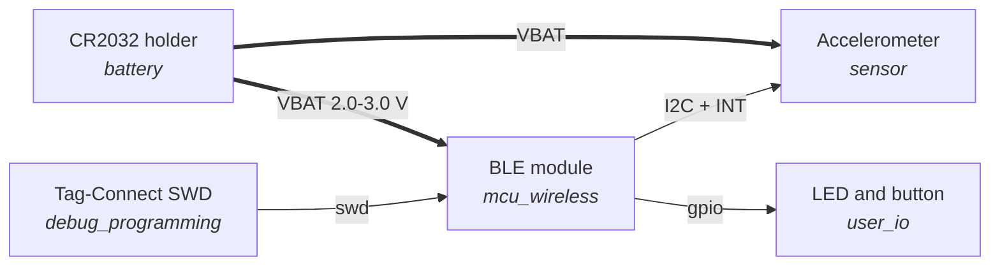

# Design report: CR2032-powered BLE asset tag with wake-on-motion accelerometer.

> **AI-GENERATED DESIGN PLAN - NOT VERIFIED FOR FABRICATION. This output was produced with the help of a language model and deterministic rule checks. It must be reviewed and signed off by a qualified electronics engineer before any fabrication, assembly or use.**

- **Check status:** `PASS_WITH_WARNINGS` (0 errors, 4 warnings, 6 info)
- **Plan version:** v1
- **Review status:** draft
- **Created:** 2026-11-28T08:16:58+00:00
- **LLM:** mock / `mock-llm` (fixtures: architecture/ble_coin_tag, netlist/ble_coin_tag, parts/ble_coin_tag, requirements/ble_coin_tag)
  - Mock mode: the LLM answers are hand-authored fixtures, not model output.
- **KiCad DRC:** KiCad DRC ran via kicad-cli-docker: Found 26 violations; Found 43 unconnected items

## Prompt

> Coin-cell BLE asset tag with an accelerometer for wake-on-motion, a status LED and a button. Programmed over SWD with a Tag-Connect cable. Should run at least a year on a CR2032. As small as practical.

## Findings

### WARNING (4)

| ID | Category | Message | Suggested fix |
|---|---|---|---|
| `DRC-ITEMS_NOT_ALLOWED:footprint` | DRC | KiCad DRC items_not_allowed: 2 item(s). Items not allowed (keepout area) [Pad 40 [<no net>] of U1 on F.Cu] \| Items not allowed (keepout area) [Pad 41 [<no net>] of U1 on F.Cu] All inside the KiCad library footprint(s) of U1: check that your fab accepts them or adapt the footprint. |  |
| `DFM-DECOUPLING-DISTANCE:C4->U2.1` | placement | C4 is 3.1 mm from U2 pin 1 (limit 3 mm). | Move the capacitor next to the pin. |
| `PWR-BATTERY-LIFE:plan` | power | Estimated battery life 385 days (average 19.0 uA, duty 0.3%, 80% usable capacity) vs target 365 days. Thin margin. |  |
| `PWR-SOURCE:VBAT` | power | VBAT: peak demand 16.0 mA exceeds what the battery source can deliver (15 mA). | Use a stronger source, add bulk capacitance for short pulses, or reduce the peak load. |

### INFO (6)

| ID | Category | Message | Suggested fix |
|---|---|---|---|
| `DRC-LIB_FOOTPRINT_ISSUES:warning` | DRC | KiCad DRC lib_footprint_issues: 14 item(s). The current configuration does not include the library 'Battery'. [Footprint BT1] \| The current configuration does not include the library 'RF_Module'. [Footprint U1] \| The current configuration does not include the library 'Package_LGA'. [Footprint U2] \| The current configuration does not include the library 'LED_SMD'. [Footprint D1] (+10 more) Expected here: the board was checked without the KiCad footprint library tables. |  |
| `DRC-SILK_EDGE_CLEARANCE:warning` | DRC | KiCad DRC silk_edge_clearance: 1 item(s). Silkscreen clipped by board edge [Segment on Edge.Cuts; Reference 'J1'] Expected here: silkscreen near the edge on edge-mounted connectors. |  |
| `DRC-SILK_OVERLAP:warning` | DRC | KiCad DRC silk_overlap: 4 item(s). Silkscreen overlap [Reference 'C1'; Segment on F.Silkscreen] \| Silkscreen overlap [Reference 'C1'; Segment on F.Silkscreen] \| Silkscreen overlap [Segment on F.Silkscreen; Reference 'C2'] \| Silkscreen overlap [Reference 'U2'; Segment on F.Silkscreen] Expected here: silkscreen reference positions come from the library footprints. |  |
| `DRC-SILK_OVER_COPPER:warning` | DRC | KiCad DRC silk_over_copper: 5 item(s). Silkscreen clipped by solder mask [Reference 'U2'] \| Silkscreen clipped by solder mask [Reference 'SW1'] \| Silkscreen clipped by solder mask [Reference 'C1'] \| Silkscreen clipped by solder mask [Reference 'C2'] (+1 more) Expected here: silkscreen reference positions come from the library footprints. |  |
| `DRC-UNCONNECTED_ITEMS:error` | DRC | KiCad DRC unconnected_items: 43 item(s). Missing connection between items [Pad 12 [GND] of U2 on F.Cu; Pad 10 [GND] of U2 on F.Cu] \| Missing connection between items [Pad 5 [GND] of U2 on F.Cu; Pad 7 [GND] of U2 on F.Cu] \| Missing connection between items [Pad 7 [GND] of U2 on F.Cu; Pad 10 [GND] of U2 on F.Cu] \| Missing connection between items [Pad 2 [GND] of C2 on F.Cu; Pad 2 [GND] of C1 on F.Cu] (+39 more) Expected here: routing is a manual step; every ratsnest line is reported. |  |
| `LIB-NO-DATASHEET:plan` | library | No trusted datasheet URL for BT1, D1, SW1, C1, C2, R1, R2, C3, C4, R3, R4 (KiCad metadata has none; URLs are never guessed). Look these up from the manufacturer. |  |

## Requirements

- advertise over BLE
- wake on motion from an accelerometer interrupt
- status LED and one button
- SWD programming through a Tag-Connect footprint

| Source | Nominal V | Range V | Capacity mAh | Max mA | Notes |
|---|---|---|---|---|---|
| coin_cell | 3.0 | 2.0-3.0 | 220.0 | 15.0 | CR2032: about 3 mA continuous, 15 mA pulse |

- target battery life 365 days
- duty cycle: BLE advertising once per second, about 3 ms radio-on per event
- size <= 40 x 30 mm
- wireless: ble
- sensors: acceleration

### Assumptions

- Advertising interval 1 s with ~3 ms active per event *(fills `duty_active_s`)*
- Single-sided assembly with the coin holder on top: 40 x 30 mm. Moving the holder to the bottom side could shrink the board to about 30 x 25 mm. *(fills `size`)*
- LED is used only briefly; excluded from the average current *(fills `user_io`)*
- Runs directly from the coin cell, no regulator (nRF52 accepts 1.7-3.6 V) *(fills `voltage_rails`)*

### Open questions

- Advertising payload and interval required by the asset system?

## Architecture

| Block | Kind | Covers |
|---|---|---|
| battery | battery | power |
| mcu | mcu_wireless | ble |
| sensor | sensor | acceleration |
| ui | user_io | status LED, button |
| debug | debug_programming | SWD |

Rationale: Direct battery supply keeps quiescent current minimal.

## Components

| Ref | Role | MPN | Value | Footprint | Verified | Conf. | Status | Rationale |
|---|---|---|---|---|---|---|---|---|
| BT1 | CR2032 holder | 3034 | 3034 | BatteryHolder_Keystone_3034_1x20mm | yes | 0.90 | proposed | Keystone SMD coin-cell retainer |
| U1 | BLE MCU module | MDBT42Q-512KV2 | MDBT42Q-512KV2 | Raytac_MDBT42Q | yes | 0.90 | proposed | nRF52832 module with chip antenna, 2 uA sleep |
| U2 | wake-on-motion accelerometer | LIS3DHTR | LIS3DHTR | LGA-16_3x3mm_P0.5mm_LayoutBorder3x5y | yes | 0.90 | proposed | low-power accelerometer with interrupt |
| D1 | status LED | LTST-C191KGKT | green | LED_0603_1608Metric | yes | 0.90 | proposed | green indicator |
| SW1 | user button | PTS810 SJM 250 SMTR LFS | PTS810 SJM 250 SMTR LFS | SW_SPST_PTS810 | yes | 0.90 | proposed | SMD tactile switch |
| J1 | SWD programming footprint | TC2030-IDC-NL | TC2030-IDC-NL | Tag-Connect_TC2030-IDC-NL_2x03_P1.27mm_Vertical | yes | 0.90 | proposed | zero-cost Tag-Connect footprint |
| C1 | Decoupling (4.7u) for BLE MCU module | GRM188R61A475KE15D | 4.7u | C_0603_1608Metric | yes | 0.90 | proposed | Decoupling on VBAT |
| C2 | Decoupling (100n) for BLE MCU module | GRM155R71C104KA88D | 100n | C_0402_1005Metric | yes | 0.90 | proposed | Decoupling on VBAT |
| R1 | I2C SDA pull-up (4.7k) | RC0402FR-074K7L | 4.7k | R_0402_1005Metric | yes | 0.90 | proposed | I2C SDA pull-up |
| R2 | I2C SCL pull-up (4.7k) | RC0402FR-074K7L | 4.7k | R_0402_1005Metric | yes | 0.90 | proposed | I2C SCL pull-up |
| C3 | Decoupling (100n) for wake-on-motion accelerometer | GRM155R71C104KA88D | 100n | C_0402_1005Metric | yes | 0.90 | proposed | Decoupling on VBAT |
| C4 | Decoupling (100n) for wake-on-motion accelerometer | GRM155R71C104KA88D | 100n | C_0402_1005Metric | yes | 0.90 | proposed | Decoupling on VBAT |
| R3 | LED series resistor (1k) | RC0402FR-071KL | 1k | R_0402_1005Metric | yes | 0.90 | proposed | LED series resistor |
| R4 | Button pull-up (10k) | RC0402FR-0710KL | 10k | R_0402_1005Metric | yes | 0.90 | proposed | Button pull-up |

## Power tree and budget

| Rail | Nominal | Range | Source | From | Capability mA | Peak mA | Active mA | Sleep uA |
|---|---|---|---|---|---|---|---|---|
| VBAT | 3 V | 2-3 V | battery BT1 | - | 15.0 | 16.0 | 5.51 | 2.5 |

Estimated battery life: **385 days** (average 19.0 uA at 0.3% duty, 80% usable capacity). Indicator LEDs are counted at peak only.

## Netlist

| Net | Class | Pins | Connections |
|---|---|---|---|
| GND | ground | 16 | BT1.2 C1.2 C2.2 C3.2 C4.2 D1.1 J1.5 SW1.2 U1.1 U1.12 U1.24 U1.39 U2.5 U2.7 U2.10 U2.12 |
| VBAT | power | 13 | BT1.1 C1.1 C2.1 C3.1 C4.1 J1.1 R1.1 R2.1 R4.1 U1.11 U2.1 U2.8 U2.14 |
| BTN1 | signal | 3 | R4.2 SW1.1 U1.20 |
| I2C_SCL | signal | 3 | R2.2 U1.3 U2.4 |
| I2C_SDA | signal | 3 | R1.2 U1.2 U2.6 |
| INT_LIS3DHTR | signal | 2 | U1.4 U2.11 |
| LED1_A | signal | 2 | D1.2 R3.2 |
| LED1_DRV | signal | 2 | R3.1 U1.19 |
| MCU_RESET | signal | 2 | J1.3 U1.35 |
| SWCLK | signal | 2 | J1.4 U1.36 |
| SWDIO | signal | 2 | J1.2 U1.37 |
| SWO | signal | 2 | J1.6 U1.32 |

33 explicit no-connects

- U1.5: unused GPIO
- U1.6: unused GPIO
- U1.7: unused GPIO
- U1.8: unused GPIO
- U1.9: internal regulator node, LDO mode (see module datasheet)
- U1.10: internal regulator node, LDO mode (see module datasheet)
- U1.13: 32 kHz crystal not fitted (internal RC oscillator)
- U1.14: 32 kHz crystal not fitted (internal RC oscillator)
- U1.15: unused GPIO
- U1.16: unused GPIO
- U1.17: unused GPIO
- U1.18: unused GPIO
- U1.21: unused GPIO
- U1.22: unused GPIO
- U1.23: unused GPIO
- U1.25: unused GPIO
- U1.26: unused GPIO
- U1.27: unused GPIO
- U1.28: unused GPIO
- U1.29: unused GPIO
- U1.30: unused GPIO
- U1.31: unused GPIO
- U1.33: unused GPIO
- U1.34: unused GPIO
- U1.38: unused GPIO
- U1.40: unused GPIO
- U1.41: unused GPIO
- U2.2: NC per KiCad symbol
- U2.3: NC per KiCad symbol
- U2.9: unused interrupt output
- U2.13: auxiliary ADC input unused
- U2.15: auxiliary ADC input unused
- U2.16: auxiliary ADC input unused

## Constraints

- Board 40 x 30 mm, 1.6 mm thick, 2 layers, fab profile `generic_2layer`.
- Trace widths: IPC-2221 external layer, dT=10C, 1 oz Cu: I = 0.048 * dT^0.44 * A^0.725 (A in mil^2).

| Net class | Width mm | Clearance mm | Via mm | Max mA | Rationale |
|---|---|---|---|---|---|
| Default | 0.2 | 0.15 | 0.6/0.3 |  | fab minimum 0.15 mm rounded up for yield |
| Power | 0.4 | 0.15 | 0.8/0.4 | 16.0 | IPC-2221 external, dT=10C, 1 oz: 16 mA x1.25 margin -> 0.001 mm (min 0.4 mm) |
| Ground | 0.4 | 0.15 | 0.6/0.3 |  | return currents; use a pour on B.Cu, short stubs elsewhere |

- Decoupling: C1, C2 within 5 mm of U1 pin 11
- Decoupling: C3, C4 within 3 mm of U2 pin 1
- U1 on the top edge (PCB antenna must overhang/face the edge)

## Placement

Algorithm: zone shelf-packing with proximity ordering (deterministic).

| Zone | Kind | Area (x, y, w, h mm) | Purpose |
|---|---|---|---|
| power | power | 0.6, 6.0, 23.7, 21.0 | Power entry, protection, charging and regulation; keep high-current loops short. |
| mcu | mcu | 25.0, 0.0, 14.5, 17.5 | MCU and its local decoupling/strapping. |
| sensor | sensor | 33.1, 23.5, 4.3, 4.7 | Sensors away from regulators and the MCU module to limit self-heating. |
| debug | debug | 25.0, 25.5, 7.0, 4.0 | Programming/debug access near a board edge. |
| general | general | 19.1, 19.5, 11.3, 9.2 | User I/O and miscellaneous parts. |

| Ref | X mm | Y mm | Rot | Zone | Hint |
|---|---|---|---|---|---|
| BT1 | 12.50 | 16.50 | 0 | power |  |
| C1 | 26.50 | 14.00 | 0 | mcu | C1 within 5mm of U1 pin 11 |
| C2 | 27.00 | 15.50 | 0 | mcu | C2 within 5mm of U1 pin 11 |
| C3 | 34.00 | 24.00 | 0 | sensor | C3 within 3mm of U2 pin 1 |
| C4 | 36.50 | 24.00 | 0 | sensor | C4 within 3mm of U2 pin 1 |
| D1 | 23.00 | 28.00 | 0 | general |  |
| J1 | 28.50 | 27.50 | 0 | debug |  |
| R1 | 27.00 | 12.50 | 0 | mcu | R1 within 10mm of U1 pin 11 |
| R2 | 27.00 | 17.00 | 0 | mcu | R2 within 10mm of U1 pin 11 |
| R3 | 20.00 | 28.00 | 0 | general | R3 within 10mm of D1 pin 2 |
| R4 | 26.00 | 20.00 | 0 | general | R4 within 10mm of SW1 pin 1 |
| SW1 | 27.50 | 23.00 | 0 | general |  |
| U1 | 34.00 | 8.55 | 0 | mcu |  |
| U2 | 35.00 | 26.50 | 0 | sensor |  |

- Coordinates are footprint origins in mm from the board's top-left corner.
- This is a deterministic starting placement; refine it in KiCad.
- Edge connectors are flush with their edge at 0 deg; rotate them so the mating face points off the board.

## Routing guidance

Stackup: F.Cu 0.035 mm / Core 1.53 mm / B.Cu 0.035 mm

1. **VBAT** - power rails at Power net-class width; star from the source
2. **decoupling** - decoupling caps: pad -> cap -> via to GND, shortest possible
3. **remaining signals** - Default net class

- Ground: 2-layer: solid GND pour on B.Cu, kept unbroken under the MCU, USB pair and regulators; GND pour on F.Cu stitched to B.Cu with vias every ~5 mm and around the board edge. Route signals on F.Cu; use B.Cu only for short jumpers so the ground plane is not cut.
- Every signal crossing between zones needs continuous GND underneath it.
- Do not route traces through the antenna keepout on any layer.
- Signal vias 0.6/0.3 mm (diameter/drill, fab minimum).
- Power/GND vias 0.8/0.4 mm; use at least two in parallel per amp of current.
- No vias inside SMD pads unless the fab offers filled/capped via-in-pad.
- C1, C2 within 5 mm of U1 pin 11 (MDBT42Q-512KV2)
- C3, C4 within 3 mm of U2 pin 1 (LIS3DHTR)

## Design notes (deterministic stages)

- Parts: 14 entries; netlist: 12 nets, accepted after 1 submission(s)

## Review

No review comments or decisions yet.

## Files

- `board.net`
- `board.kicad_pro`
- `board.kicad_sch`
- `board.kicad_pcb`
- `drc.json`
- `bom.csv`
- `report.md`

---

*AI-GENERATED DESIGN PLAN - NOT VERIFIED FOR FABRICATION. This output was produced with the help of a language model and deterministic rule checks. It must be reviewed and signed off by a qualified electronics engineer before any fabrication, assembly or use.*
