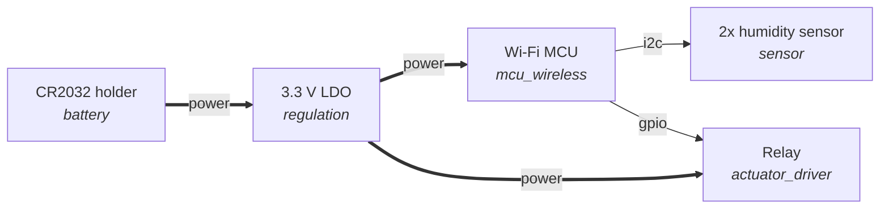

# Design report: Wi-Fi T/RH logger on a CR2032 with a 5 V relay, two sensors, 15 x 15 mm.

> **AI-GENERATED DESIGN PLAN - NOT VERIFIED FOR FABRICATION. This output was produced with the help of a language model and deterministic rule checks. It must be reviewed and signed off by a qualified electronics engineer before any fabrication, assembly or use.**

- **Check status:** `FAIL` (14 errors, 10 warnings, 6 info)
- **Plan version:** v1
- **Review status:** draft
- **Created:** 2026-11-28T08:17:05+00:00
- **LLM:** mock / `mock-llm` (fixtures: architecture/flawed_coin_wifi, netlist/flawed_coin_wifi, parts/flawed_coin_wifi, requirements/flawed_coin_wifi)
  - Mock mode: the LLM answers are hand-authored fixtures, not model output.
- **KiCad DRC:** KiCad DRC ran via kicad-cli-docker: Found 39 violations; Found 30 unconnected items

## Prompt

> Wi-Fi temperature and humidity logger that runs for 2 years on a single CR2032 coin cell, uploads a reading every 10 seconds, switches a 5 V relay, uses two identical humidity sensors for redundancy, and fits on a 15 x 15 mm board.

## Findings

### ERROR (14)

| ID | Category | Message | Suggested fix |
|---|---|---|---|
| `ERC-I2C-ADDRESS:I2C_SDA:0x44` | ERC | U3, U4 share I2C address 0x44 on I2C_SDA. | Use parts with selectable addresses, an I2C mux, or a second bus. |
| `ERC-SUPPLY-RANGE:K1:+3V3` | ERC | K1 (SRD-05VDC-SL-C) runs from +3V3 = 3.3 V but needs 3.75-5.5 V. | Power it from a rail inside its supply range. |
| `CON-BOARD-AREA:plan` | placement | Requested board 15 x 15 mm = 225 mm^2 but the parts' courtyards need about 1679 mm^2 before any routing space. | Enlarge the board, use a double-sided assembly, or drop parts. |
| `DFM-UNPLACED:plan` | placement | 6 part(s) could not be placed: BT1, U2, K1, SW1, SW2, Q1. | Enlarge the board or remove parts. |
| `PLACE-NO-SPACE:BT1` | placement | BT1 (3034) does not fit on the 15 x 15 mm board. | Enlarge the board or remove parts. |
| `PLACE-NO-SPACE:K1` | placement | K1 (SRD-05VDC-SL-C) does not fit on the 15 x 15 mm board. | Enlarge the board or remove parts. |
| `PLACE-NO-SPACE:Q1` | placement | Q1 (AO3400A) does not fit on the 15 x 15 mm board. | Enlarge the board or remove parts. |
| `PLACE-NO-SPACE:SW1` | placement | SW1 (PTS810 SJM 250 SMTR LFS) does not fit on the 15 x 15 mm board. | Enlarge the board or remove parts. |
| `PLACE-NO-SPACE:SW2` | placement | SW2 (PTS810 SJM 250 SMTR LFS) does not fit on the 15 x 15 mm board. | Enlarge the board or remove parts. |
| `PLACE-NO-SPACE:U2` | placement | U2 (ESP32-C3-WROOM-02-N4) does not fit on the 15 x 15 mm board. | Enlarge the board or remove parts. |
| `PWR-BATTERY-LIFE:plan` | power | Estimated battery life 0 days (average 88133.7 uA, duty 20%, 80% usable capacity) vs target 730 days. | Reduce active time/rate, cut sleep current, or use a bigger battery. |
| `PWR-DROPOUT:+3V3` | power | U1 cannot regulate +3V3 (3.3 V) from VBAT (3 V nominal): needs at least 3.48 V including 178 mV dropout. | Use a buck-boost/boost converter or a higher input voltage. |
| `PWR-REG-CAPACITY:+3V3` | power | +3V3: peak load 423.0 mA exceeds U1 rating 250 mA. | Choose a regulator with more output current. |
| `PWR-SOURCE:VBAT` | power | VBAT: peak demand 423.0 mA exceeds what the battery source can deliver (15 mA). | Use a stronger source, add bulk capacitance for short pulses, or reduce the peak load. |

### WARNING (10)

| ID | Category | Message | Suggested fix |
|---|---|---|---|
| `DFM-DRILL:U2` | DFM | U2 pad 19 drill 0.2 mm < fab minimum 0.3 mm (thermal vias inside the footprint's ground pad). | Use a fab that drills this size, or edit the footprint's thermal vias to the fab minimum. |
| `ERC-SINGLE-PIN-NET:RELAY1_COM` | ERC | Net RELAY1_COM has only 1 connection(s). | Connect it to its destination (e.g. a terminal) or remove it. |
| `ERC-SINGLE-PIN-NET:RELAY1_K3` | ERC | Net RELAY1_K3 has only 1 connection(s). | Connect it to its destination (e.g. a terminal) or remove it. |
| `ERC-SINGLE-PIN-NET:RELAY1_K4` | ERC | Net RELAY1_K4 has only 1 connection(s). | Connect it to its destination (e.g. a terminal) or remove it. |
| `ERC-SUPPLY-RANGE:U1:VBAT` | ERC | VBAT can fall to 2 V, below U1 minimum 2.3 V (brown-out at the end of the source's range). |  |
| `LIB-KICAD-ONLY:U5` | library | U5 (MMBT3904) is not in the curated library: pins from KiCad symbol Transistor_BJT:MMBT3904, footprint Package_TO_SOT_SMD:SOT-23; MPN, footprint match and ratings are not verified. | Check the MPN, package and ratings against the datasheet. |
| `PLACE-EDGE:U2` | placement | U2 could not be placed on the top edge. |  |
| `REQ-CONFLICT:1` | requirements | Requirement conflict: A CR2032 cannot source Wi-Fi transmit peaks (300+ mA). | Resolve with the requester before sign-off. |
| `REQ-CONFLICT:2` | requirements | Requirement conflict: 2-year life with an upload every 10 s is not achievable on 220 mAh. | Resolve with the requester before sign-off. |
| `REQ-CONFLICT:3` | requirements | Requirement conflict: A 15 x 15 mm board cannot hold a CR2032 holder plus a Wi-Fi module. | Resolve with the requester before sign-off. |

### INFO (6)

| ID | Category | Message | Suggested fix |
|---|---|---|---|
| `DFM-MIXED-ASSEMBLY:plan` | DFM | 1 through-hole part(s) (K1) need a second assembly step (wave/selective/hand soldering). |  |
| `DRC-LIB_FOOTPRINT_ISSUES:warning` | DRC | KiCad DRC lib_footprint_issues: 19 item(s). The current configuration does not include the library 'Package_TO_SOT_SMD'. [Footprint U1] \| The current configuration does not include the library 'Sensor_Humidity'. [Footprint U3] \| The current configuration does not include the library 'Sensor_Humidity'. [Footprint U4] \| The current configuration does not include the library 'Package_TO_SOT_SMD'. [Footprint U5] (+15 more) Expected here: the board was checked without the KiCad footprint library tables. |  |
| `DRC-SILK_OVERLAP:warning` | DRC | KiCad DRC silk_overlap: 7 item(s). Silkscreen overlap [Segment on F.Silkscreen; Reference 'C2'] \| Silkscreen overlap [Reference 'U3'; Segment on F.Silkscreen] \| Silkscreen overlap [Segment on F.Silkscreen; Reference 'C7'] \| Silkscreen overlap [Segment on F.Silkscreen; Reference 'C3'] (+3 more) Expected here: silkscreen reference positions come from the library footprints. |  |
| `DRC-SILK_OVER_COPPER:warning` | DRC | KiCad DRC silk_over_copper: 13 item(s). Silkscreen clipped by solder mask [Reference 'U1'] \| Silkscreen clipped by solder mask [Reference 'U3'] \| Silkscreen clipped by solder mask [Reference 'U4'] \| Silkscreen clipped by solder mask [Reference 'C1'] (+9 more) Expected here: silkscreen reference positions come from the library footprints. |  |
| `DRC-UNCONNECTED_ITEMS:error` | DRC | KiCad DRC unconnected_items: 30 item(s). Missing connection between items [Pad 2 [GND] of C3 on F.Cu; Pad 2 [GND] of C4 on F.Cu] \| Missing connection between items [Pad 4 [GND] of U3 on F.Cu; Pad 2 [GND] of C6 on F.Cu] \| Missing connection between items [Pad 2 [GND] of C3 on F.Cu; Pad 4 [GND] of U4 on F.Cu] \| Missing connection between items [Pad 4 [GND] of U4 on F.Cu; Pad 2 [GND] of C7 on F.Cu] (+26 more) Expected here: routing is a manual step; every ratsnest line is reported. |  |
| `LIB-NO-DATASHEET:plan` | library | No trusted datasheet URL for BT1, C1, C2, C3, C4, R1, C5, R2, R3, SW1, SW2, R4, R5, C6, C7, R6, R7 (KiCad metadata has none; URLs are never guessed). Look these up from the manufacturer. |  |

## Requirements

- upload a temperature/humidity reading every 10 s over Wi-Fi
- run 2 years on one CR2032
- switch a 5 V relay
- two identical humidity sensors for redundancy

| Source | Nominal V | Range V | Capacity mAh | Max mA | Notes |
|---|---|---|---|---|---|
| coin_cell | 3.0 | 2.0-3.0 | 220.0 | 15.0 | CR2032: about 3 mA continuous, 15 mA pulse |

- target battery life 730 days
- duty cycle: upload every 10 s, ~2 s awake
- size <= 15 x 15 mm
- wireless: wifi
- sensors: humidity, temperature
- actuators: relay

### Assumptions

- Relay coil runs from the logic supply *(fills `actuators`)*

### Open questions

- Is mains/USB power available instead of the coin cell?

### Conflicts

- A CR2032 cannot source Wi-Fi transmit peaks (300+ mA).
- 2-year life with an upload every 10 s is not achievable on 220 mAh.
- A 15 x 15 mm board cannot hold a CR2032 holder plus a Wi-Fi module.

## Architecture

| Block | Kind | Covers |
|---|---|---|
| battery | battery |  |
| regulator | regulation |  |
| mcu | mcu_wireless |  |
| sensors | sensor |  |
| relay | actuator_driver |  |

Rationale: As requested, although several requirements conflict.

## Components

| Ref | Role | MPN | Value | Footprint | Verified | Conf. | Status | Rationale |
|---|---|---|---|---|---|---|---|---|
| BT1 | CR2032 holder | 3034 | 3034 | BatteryHolder_Keystone_3034_1x20mm | yes | 0.90 | proposed | requested coin cell |
| U1 | 3.3 V LDO | MCP1700T-3302E/TT | MCP1700T-3302E/TT | SOT-23 | yes | 0.90 | proposed | 1.6 uA quiescent current |
| U2 | Wi-Fi MCU | ESP32-C3-WROOM-02-N4 | ESP32-C3-WROOM-02-N4 | ESP32-C3-WROOM-02 | yes | 0.90 | proposed | Wi-Fi requested |
| U3 | humidity sensor #1 | SHT40-AD1B-R3 | SHT40-AD1B-R3 | Sensirion_DFN-4_1.5x1.5mm_P0.8mm_SHT4x_NoCentralPad | yes | 0.90 | proposed | two identical sensors as requested |
| U4 | humidity sensor #2 | SHT40-AD1B-R3 | SHT40-AD1B-R3 | Sensirion_DFN-4_1.5x1.5mm_P0.8mm_SHT4x_NoCentralPad | yes | 0.90 | proposed | two identical sensors as requested |
| K1 | 5 V relay | SRD-05VDC-SL-C | SRD-05VDC-SL-C | Relay_SPDT_SANYOU_SRD_Series_Form_C | yes | 0.90 | proposed | 5 V relay requested |
| U5 | relay driver transistor | MMBT3904 | MMBT3904 | SOT-23 | pins only | 0.60 | proposed | generic NPN; not in the candidate list |
| C1 | Input capacitor (1u) for 3.3 V LDO | GRM155R61A105KE15D | 1u | C_0402_1005Metric | yes | 0.90 | proposed | Input capacitor on VBAT |
| C2 | Output capacitor (1u) for 3.3 V LDO | GRM155R61A105KE15D | 1u | C_0402_1005Metric | yes | 0.90 | proposed | Output capacitor on +3V3 |
| C3 | Decoupling (10u) for Wi-Fi MCU | GRM188R61A106KE69D | 10u | C_0603_1608Metric | yes | 0.90 | proposed | Decoupling on +3V3 |
| C4 | Decoupling (100n) for Wi-Fi MCU | GRM155R71C104KA88D | 100n | C_0402_1005Metric | yes | 0.90 | proposed | Decoupling on +3V3 |
| R1 | EN pull-up (10k) | RC0402FR-0710KL | 10k | R_0402_1005Metric | yes | 0.90 | proposed | EN pull-up |
| C5 | EN reset-delay capacitor (1u) for Wi-Fi MCU | GRM155R61A105KE15D | 1u | C_0402_1005Metric | yes | 0.90 | proposed | EN reset-delay capacitor on MCU_EN |
| R2 | Strapping pull-up IO2 (10k) | RC0402FR-0710KL | 10k | R_0402_1005Metric | yes | 0.90 | proposed | Strapping pull-up IO2 |
| R3 | Strapping pull-up IO8 (10k) | RC0402FR-0710KL | 10k | R_0402_1005Metric | yes | 0.90 | proposed | Strapping pull-up IO8 |
| SW1 | BOOT button (hold during reset for download mode) | PTS810 SJM 250 SMTR LFS | PTS810 SJM 250 SMTR LFS | SW_SPST_PTS810 | yes | 0.90 | proposed | boot strapping pin needs a way to be pulled low |
| SW2 | RESET (EN) button | PTS810 SJM 250 SMTR LFS | PTS810 SJM 250 SMTR LFS | SW_SPST_PTS810 | yes | 0.90 | proposed | no USB auto-reset; manual reset needed for programming |
| R4 | I2C SDA pull-up (4.7k) | RC0402FR-074K7L | 4.7k | R_0402_1005Metric | yes | 0.90 | proposed | I2C SDA pull-up |
| R5 | I2C SCL pull-up (4.7k) | RC0402FR-074K7L | 4.7k | R_0402_1005Metric | yes | 0.90 | proposed | I2C SCL pull-up |
| C6 | Decoupling (100n) for humidity sensor #1 | GRM155R71C104KA88D | 100n | C_0402_1005Metric | yes | 0.90 | proposed | Decoupling on +3V3 |
| C7 | Decoupling (100n) for humidity sensor #2 | GRM155R71C104KA88D | 100n | C_0402_1005Metric | yes | 0.90 | proposed | Decoupling on +3V3 |
| Q1 | Low-side relay driver for 5 V relay | AO3400A | AO3400A | SOT-23 | yes | 0.90 | proposed | logic-level N-MOSFET switches the coil from a 3.3 V GPIO |
| D1 | Flyback diode across 5 V relay coil | 1N4148W-7-F | 1N4148W-7-F | D_SOD-123 | yes | 0.90 | proposed | clamps the coil's inductive kick when the FET turns off |
| R6 | Gate series resistor (1k) | RC0402FR-071KL | 1k | R_0402_1005Metric | yes | 0.90 | proposed | Gate series resistor |
| R7 | Gate pull-down (relay off at reset) (100k) | RC0402FR-07100KL | 100k | R_0402_1005Metric | yes | 0.90 | proposed | Gate pull-down (relay off at reset) |

## Power tree and budget

| Rail | Nominal | Range | Source | From | Capability mA | Peak mA | Active mA | Sleep uA |
|---|---|---|---|---|---|---|---|---|
| +3V3 | 3.3 V | 3.201-3.399 V | ldo U1 | VBAT | 250.0 | 423.0 | 156.64 | 71005.2 |
| VBAT | 3 V | 2-3 V | battery BT1 | - | 15.0 | 423.0 | 156.64 | 71006.8 |

Estimated battery life: **0 days** (average 88133.7 uA at 20% duty, 80% usable capacity). Indicator LEDs are counted at peak only.

## Netlist

| Net | Class | Pins | Connections |
|---|---|---|---|
| GND | ground | 17 | BT1.2 C1.2 C2.2 C3.2 C4.2 C5.2 C6.2 C7.2 Q1.2 R7.2 SW1.2 SW2.2 U1.1 U2.9 U2.19 U3.4 U4.4 |
| +3V3 | power | 16 | C2.1 C3.1 C4.1 C6.1 C7.1 D1.1 K1.2 R1.1 R2.1 R3.1 R4.1 R5.1 U1.2 U2.1 U3.3 U4.3 |
| VBAT | power | 3 | BT1.1 C1.1 U1.3 |
| I2C_SCL | signal | 4 | R5.2 U2.6 U3.2 U4.2 |
| I2C_SDA | signal | 4 | R4.2 U2.5 U3.1 U4.1 |
| MCU_BOOT | signal | 2 | SW1.1 U2.8 |
| MCU_EN | signal | 4 | C5.1 R1.2 SW2.1 U2.2 |
| RELAY1_COIL | power | 3 | D1.2 K1.5 Q1.3 |
| RELAY1_COM | power | 1 | K1.1 |
| RELAY1_DRV | signal | 2 | R6.1 U2.10 |
| RELAY1_GATE | signal | 3 | Q1.1 R6.2 R7.1 |
| RELAY1_K3 | power | 1 | K1.3 |
| RELAY1_K4 | power | 1 | K1.4 |
| STRAP_IO2 | signal | 2 | R2.2 U2.16 |
| STRAP_IO8 | signal | 2 | R3.2 U2.7 |

12 explicit no-connects

- U2.3: unused GPIO
- U2.4: unused GPIO
- U2.11: UART0 console pin not brought out
- U2.12: UART0 console pin not brought out
- U2.13: native USB unused
- U2.14: native USB unused
- U2.15: unused GPIO
- U2.17: unused GPIO
- U2.18: unused GPIO
- U5.1: left unwired: the synthesizer only wires curated parts (this example keeps the gap on purpose)
- U5.2: left unwired: the synthesizer only wires curated parts (this example keeps the gap on purpose)
- U5.3: left unwired: the synthesizer only wires curated parts (this example keeps the gap on purpose)

## Constraints

- Board 15 x 15 mm, 1.6 mm thick, 2 layers, fab profile `generic_2layer`.
- Trace widths: IPC-2221 external layer, dT=10C, 1 oz Cu: I = 0.048 * dT^0.44 * A^0.725 (A in mil^2).

| Net class | Width mm | Clearance mm | Via mm | Max mA | Rationale |
|---|---|---|---|---|---|
| Default | 0.2 | 0.15 | 0.6/0.3 |  | fab minimum 0.15 mm rounded up for yield |
| Power | 0.4 | 0.15 | 0.8/0.4 | 423.0 | IPC-2221 external, dT=10C, 1 oz: 423 mA x1.25 margin -> 0.125 mm (min 0.4 mm) |
| Ground | 0.4 | 0.15 | 0.6/0.3 |  | return currents; use a pour on B.Cu, short stubs elsewhere |

- Decoupling: C2 within 3 mm of U1 pin 2
- Decoupling: C1 within 3 mm of U1 pin 3
- Decoupling: C3, C4 within 5 mm of U2 pin 1
- Decoupling: C6 within 3 mm of U3 pin 3
- Decoupling: C7 within 3 mm of U4 pin 3
- U2 on the top edge (PCB antenna must overhang/face the edge)

## Placement

Algorithm: zone shelf-packing with proximity ordering (deterministic).

| Zone | Kind | Area (x, y, w, h mm) | Purpose |
|---|---|---|---|
| power | power | 1.1, 5.0, 3.8, 5.9 | Power entry, protection, charging and regulation; keep high-current loops short. |
| mcu | mcu | 4.1, 3.0, 6.9, 9.4 | MCU and its local decoupling/strapping. |
| driver | driver | 1.1, 2.0, 12.8, 11.6 | Actuator drivers next to their output terminals; wide copper for load current. |
| sensor | sensor | 7.3, 7.5, 7.1, 6.5 | Sensors away from regulators and the MCU module to limit self-heating. |

| Ref | X mm | Y mm | Rot | Zone | Hint |
|---|---|---|---|---|---|
| C1 | 4.00 | 5.50 | 0 | power | C1 within 3mm of U1 pin 3 |
| C2 | 2.00 | 10.50 | 0 | power | C2 within 3mm of U1 pin 2 |
| C3 | 7.50 | 6.50 | 0 | mcu | C3 within 5mm of U2 pin 1 |
| C4 | 7.50 | 5.00 | 0 | mcu | C4 within 5mm of U2 pin 1 |
| C5 | 6.50 | 10.50 | 0 | mcu | C5 within 10mm of U2 pin 2 |
| C6 | 13.50 | 11.00 | 0 | sensor | C6 within 3mm of U3 pin 3 |
| C7 | 9.00 | 10.50 | 0 | sensor | C7 within 3mm of U4 pin 3 |
| D1 | 3.50 | 12.50 | 0 | driver | D1 within 10mm of K1 pin 2 |
| R1 | 10.00 | 5.00 | 0 | mcu | R1 within 10mm of U2 pin 1 |
| R2 | 5.00 | 4.00 | 0 | mcu | R2 within 10mm of U2 pin 1 |
| R3 | 7.50 | 3.50 | 0 | mcu | R3 within 10mm of U2 pin 1 |
| R4 | 10.00 | 3.50 | 0 | mcu | R4 within 10mm of U2 pin 1 |
| R5 | 7.50 | 12.00 | 0 | mcu | R5 within 10mm of U2 pin 1 |
| R6 | 10.00 | 12.00 | 0 | driver | R6 within 10mm of Q1 pin 1 |
| R7 | 5.00 | 2.50 | 0 | driver | R7 within 10mm of Q1 pin 1 |
| U1 | 3.00 | 8.00 | 0 | power |  |
| U3 | 13.00 | 13.00 | 0 | sensor |  |
| U4 | 8.50 | 8.50 | 0 | sensor |  |
| U5 | 12.00 | 7.50 | 0 | driver |  |

- Coordinates are footprint origins in mm from the board's top-left corner.
- This is a deterministic starting placement; refine it in KiCad.
- Edge connectors are flush with their edge at 0 deg; rotate them so the mating face points off the board.

## Routing guidance

Stackup: F.Cu 0.035 mm / Core 1.53 mm / B.Cu 0.035 mm

1. **+3V3, VBAT** - power rails at Power net-class width; star from the source
2. **decoupling** - decoupling caps: pad -> cap -> via to GND, shortest possible
3. **remaining signals** - Default net class

- Ground: 2-layer: solid GND pour on B.Cu, kept unbroken under the MCU, USB pair and regulators; GND pour on F.Cu stitched to B.Cu with vias every ~5 mm and around the board edge. Route signals on F.Cu; use B.Cu only for short jumpers so the ground plane is not cut.
- Every signal crossing between zones needs continuous GND underneath it.
- Do not route traces through the antenna keepout on any layer.
- Signal vias 0.6/0.3 mm (diameter/drill, fab minimum).
- Power/GND vias 0.8/0.4 mm; use at least two in parallel per amp of current.
- No vias inside SMD pads unless the fab offers filled/capped via-in-pad.
- C2 within 3 mm of U1 pin 2 (MCP1700T-3302E/TT)
- C1 within 3 mm of U1 pin 3 (MCP1700T-3302E/TT)
- C3, C4 within 5 mm of U2 pin 1 (ESP32-C3-WROOM-02-N4)
- C6 within 3 mm of U3 pin 3 (SHT40-AD1B-R3)
- C7 within 3 mm of U4 pin 3 (SHT40-AD1B-R3)
- K1 contacts: keep contact traces >= 2 mm from logic and wide enough for the switched load (only low-voltage loads are in scope).

## Design notes (deterministic stages)

- Parts: 25 entries; netlist: 15 nets, accepted after 5 submission(s) (NOT accepted: open problems listed)

## Review

No review comments or decisions yet.

## Files

- `board.net`
- `board.kicad_pro`
- `board.kicad_sch`
- `board.kicad_pcb`
- `drc.json`
- `bom.csv`
- `report.md`

---

*AI-GENERATED DESIGN PLAN - NOT VERIFIED FOR FABRICATION. This output was produced with the help of a language model and deterministic rule checks. It must be reviewed and signed off by a qualified electronics engineer before any fabrication, assembly or use.*
