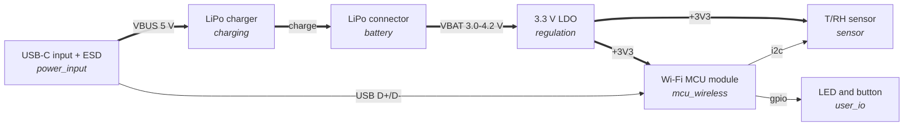

# Design report: Battery-powered Wi-Fi temperature/humidity sensor with USB-C LiPo charging.

> **AI-GENERATED DESIGN PLAN - NOT VERIFIED FOR FABRICATION. This output was produced with the help of a language model and deterministic rule checks. It must be reviewed and signed off by a qualified electronics engineer before any fabrication, assembly or use.**

- **Check status:** `PASS_WITH_WARNINGS` (0 errors, 7 warnings, 6 info)
- **Plan version:** v2 (from v1)
- **Review status:** draft
- **Created:** 2026-11-28T08:17:12+00:00
- **LLM:** mock / `mock-llm` (fixtures: netlist/iot_env_sensor_refine_bme280, parts/iot_env_sensor_refine_bme280)
  - Mock mode: the LLM answers are hand-authored fixtures, not model output.
- **KiCad DRC:** KiCad DRC ran via kicad-cli-docker: Found 92 violations; Found 90 unconnected items

## Prompt

> Battery-powered Wi-Fi temperature and humidity sensor. 1000 mAh LiPo charged over USB-C. Wakes every 15 minutes, measures and reports over Wi-Fi, then deep-sleeps; needs at least 3 months of battery life. Status LED and one user button. Board no larger than 50 x 35 mm.

Reviewer feedback applied, oldest first:

1. Replace the SHT40 with a BME280 so we also get barometric pressure.

## Findings

### WARNING (7)

| ID | Category | Message | Suggested fix |
|---|---|---|---|
| `DFM-DRILL:U3` | DFM | U3 pad 19 drill 0.2 mm < fab minimum 0.3 mm (thermal vias inside the footprint's ground pad). | Use a fab that drills this size, or edit the footprint's thermal vias to the fab minimum. |
| `DRC-DRILL_OUT_OF_RANGE:footprint` | DRC | KiCad DRC drill_out_of_range: 12 item(s). Hole size out of range (board setup constraints min hole 0.3000 mm; actual 0.2000 mm) [PTH pad 19 [GND] of U3] \| Hole size out of range (board setup constraints min hole 0.3000 mm; actual 0.2000 mm) [PTH pad 19 [GND] of U3] \| Hole size out of range (board setup constraints min hole 0.3000 mm; actual 0.2000 mm) [PTH pad 19 [GND] of U3] \| Hole size out of range (board setup constraints min hole 0.3000 mm; actual 0.2000 mm) [PTH pad 19 [GND] of U3] (+8 more) All inside the KiCad library footprint(s) of U3: check that your fab accepts them or adapt the footprint. |  |
| `DRC-HOLE_CLEARANCE:footprint` | DRC | KiCad DRC hole_clearance: 4 item(s). Hole clearance violation (board setup constraints hole clearance 0.2500 mm; actual 0.1944 mm) [NPTH pad of J1; Pad A1 [GND] of J1 on F.Cu] \| Hole clearance violation (board setup constraints hole clearance 0.2500 mm; actual 0.1944 mm) [NPTH pad of J1; Pad B12 [GND] of J1 on F.Cu] \| Hole clearance violation (board setup constraints hole clearance 0.2500 mm; actual 0.1944 mm) [NPTH pad of J1; Pad A12 [GND] of J1 on F.Cu] \| Hole clearance violation (board setup constraints hole clearance 0.2500 mm; actual 0.1944 mm) [NPTH pad of J1; Pad B1 [GND] of J1 on F.Cu] All inside the KiCad library footprint(s) of J1: check that your fab accepts them or adapt the footprint. |  |
| `DFM-DECOUPLING-DISTANCE:C8->U4.2` | placement | C8 is 3.1 mm from U4 pin 2 (limit 3 mm). | Move the capacitor next to the pin. |
| `PWR-BATTERY-LIFE:plan` | power | Estimated battery life 96 days (average 345.5 uA, duty 0.333%, 80% usable capacity) vs target 90 days. Thin margin. |  |
| `PWR-DROPOUT:+3V3` | power | U2 drops out below VBAT = 3.55 V; at VBAT minimum (3 V) +3V3 falls to ~2.75 V. Loads need >= 3 V, so the source is only usable down to ~3.25 V. | Accept the reduced usable range or use a buck-boost regulator. |
| `PWR-SOURCE:VBUS` | power | VBUS: peak demand 503.5 mA exceeds what the usb source can deliver (500 mA). | Use a stronger source, add bulk capacitance for short pulses, or reduce the peak load. |

### INFO (6)

| ID | Category | Message | Suggested fix |
|---|---|---|---|
| `DFM-MIXED-ASSEMBLY:plan` | DFM | 1 through-hole part(s) (J1) need a second assembly step (wave/selective/hand soldering). |  |
| `DRC-LIB_FOOTPRINT_ISSUES:warning` | DRC | KiCad DRC lib_footprint_issues: 34 item(s). The current configuration does not include the library 'Connector_USB'. [Footprint J1] \| The current configuration does not include the library 'Package_TO_SOT_SMD'. [Footprint D1] \| The current configuration does not include the library 'Package_TO_SOT_SMD'. [Footprint U1] \| The current configuration does not include the library 'LED_SMD'. [Footprint D2] (+30 more) Expected here: the board was checked without the KiCad footprint library tables. |  |
| `DRC-SILK_OVERLAP:warning` | DRC | KiCad DRC silk_overlap: 22 item(s). Silkscreen overlap [Reference 'D2'; Segment on F.Silkscreen] \| Silkscreen overlap [Reference 'D2'; Segment on F.Silkscreen] \| Silkscreen overlap [Reference 'U1'; Segment on F.Silkscreen] \| Silkscreen overlap [Segment on F.Silkscreen; Reference 'C1'] (+18 more) Expected here: silkscreen reference positions come from the library footprints. |  |
| `DRC-SILK_OVER_COPPER:warning` | DRC | KiCad DRC silk_over_copper: 20 item(s). Silkscreen clipped by solder mask [Reference 'D1'] \| Silkscreen clipped by solder mask [Reference 'U1'] \| Silkscreen clipped by solder mask [Reference 'D2'] \| Silkscreen clipped by solder mask [Reference 'U2'] (+16 more) Expected here: silkscreen reference positions come from the library footprints. |  |
| `DRC-UNCONNECTED_ITEMS:error` | DRC | KiCad DRC unconnected_items: 90 item(s). Missing connection between items [Pad A1 [GND] of J1 on F.Cu; PTH pad S1 [GND] of J1] \| Missing connection between items [PTH pad S1 [GND] of J1; Pad B1 [GND] of J1 on F.Cu] \| Missing connection between items [Pad 7 [GND] of U4 on F.Cu; Pad 5 [GND] of U4 on F.Cu] \| Missing connection between items [Pad 2 [GND] of C8 on F.Cu; Pad 2 [GND] of C10 on F.Cu] (+86 more) Expected here: routing is a manual step; every ratsnest line is reported. |  |
| `LIB-NO-DATASHEET:plan` | library | No trusted datasheet URL for D2, J2, D3, SW1, C1, C2, R1, R2, C3, C4, C5, C6, R3, C7, R4, R5, SW2, R6, R7, R8, R9, C10, C8, R10, R11, R12, R13, C9 (KiCad metadata has none; URLs are never guessed). Look these up from the manufacturer. |  |

## Requirements

- measure temperature and relative humidity every 15 minutes
- report readings over Wi-Fi then deep-sleep
- charge a 1000 mAh LiPo from USB-C
- status LED and one user button

| Source | Nominal V | Range V | Capacity mAh | Max mA | Notes |
|---|---|---|---|---|---|
| lipo_1s | 3.7 | 3.0-4.2 | 1000.0 | 1000.0 | single cell with built-in protection PCB assumed |
| usb_5v | 5.0 | 4.75-5.25 |  | 500.0 | USB 2.0 default power; no PD negotiation |

- target battery life 90 days
- duty cycle: wake every 15 min, about 3 s awake (sensor read + Wi-Fi report)
- size <= 50 x 35 mm
- wireless: wifi
- sensors: temperature, humidity

### Assumptions

- Indoor use, 0-50 C *(fills `environment`)*
- About 3 s awake per report (connect, measure, publish) *(fills `duty_active_s`)*
- LiPo has its own protection circuit (no on-board protector) *(fills `power_sources`)*
- 2-layer board is sufficient *(fills `layer_count_target`)*
- USB is used for charging and native-USB programming *(fills `interfaces`)*

### Open questions

- Which cloud protocol/backend (MQTT, HTTP)?
- Enclosure and venting for accurate humidity readings?

## Architecture

| Block | Kind | Covers |
|---|---|---|
| usb_in | power_input | usb |
| charger | charging | charging |
| battery | battery | battery |
| regulator | regulation | +3V3 |
| mcu | mcu_wireless | wifi |
| sensor | sensor | temperature, humidity |
| ui | user_io | status LED, user button |

Rationale: Single Wi-Fi SoC module; LDO from the battery so the board runs without USB.

## Components

| Ref | Role | MPN | Value | Footprint | Verified | Conf. | Status | Rationale |
|---|---|---|---|---|---|---|---|---|
| J1 | USB-C receptacle (charging + data) | USB4105-GF-A | USB4105-GF-A | USB_C_Receptacle_GCT_USB4105-xx-A_16P_TopMnt_Horizontal | yes | 0.90 | proposed | USB 2.0 sink receptacle in the library |
| D1 | USB ESD protection | USBLC6-2SC6 | USBLC6-2SC6 | SOT-23-6 | yes | 0.90 | proposed | standard 2-line TVS array for D+/D- and VBUS |
| U1 | LiPo linear charger | MCP73831T-2ACI/OT | MCP73831T-2ACI/OT | SOT-23-5 | yes | 0.90 | proposed | single-cell 4.2 V charger, 500 mA max, tiny SOT-23-5 |
| D2 | charge status LED | LTST-C191KRKT | red | LED_0603_1608Metric | yes | 0.90 | proposed | red LED driven by the charger STAT pin |
| J2 | LiPo battery connector | S2B-PH-SM4-TB(LF)(SN) | S2B-PH-SM4-TB(LF)(SN) | JST_PH_S2B-PH-SM4-TB_1x02-1MP_P2.00mm_Horizontal | yes | 0.90 | proposed | JST-PH is the common LiPo lead |
| U2 | 3.3 V LDO | AP2112K-3.3TRG1 | AP2112K-3.3TRG1 | SOT-23-5 | yes | 0.90 | proposed | 600 mA covers ESP32-C3 Wi-Fi TX peaks; 250 mV dropout |
| U3 | main Wi-Fi MCU | ESP32-C3-WROOM-02-N4 | ESP32-C3-WROOM-02-N4 | ESP32-C3-WROOM-02 | yes | 0.90 | proposed | low-cost Wi-Fi/BLE module with native USB and deep sleep |
| U4 | temperature/humidity/pressure sensor | BME280 | BME280 | Bosch_LGA-8_2.5x2.5mm_P0.65mm_ClockwisePinNumbering | yes | 0.90 | proposed | reviewer asked for barometric pressure; BME280 adds it on the same bus |
| D3 | status LED | LTST-C191KGKT | green | LED_0603_1608Metric | yes | 0.90 | proposed | green status indicator |
| SW1 | user button | PTS810 SJM 250 SMTR LFS | PTS810 SJM 250 SMTR LFS | SW_SPST_PTS810 | yes | 0.90 | proposed | small SMD tactile switch |
| C1 | Input capacitor (4.7u) for LiPo linear charger | GRM188R61A475KE15D | 4.7u | C_0603_1608Metric | yes | 0.90 | proposed | Input capacitor on VBUS |
| C2 | Output capacitor (4.7u) for LiPo linear charger | GRM188R61A475KE15D | 4.7u | C_0603_1608Metric | yes | 0.90 | proposed | Output capacitor on VBAT |
| R1 | Charge-current program resistor, I_REG = 1000/R = 500 mA (2k) | RC0603FR-072KL | 2k | R_0603_1608Metric | yes | 0.90 | proposed | Charge-current program resistor, I_REG = 1000/R = 500 mA |
| R2 | Charge LED series resistor (1k) | RC0402FR-071KL | 1k | R_0402_1005Metric | yes | 0.90 | proposed | Charge LED series resistor |
| C3 | Input capacitor (1u) for 3.3 V LDO | GRM155R61A105KE15D | 1u | C_0402_1005Metric | yes | 0.90 | proposed | Input capacitor on VBAT |
| C4 | Output capacitor (1u) for 3.3 V LDO | GRM155R61A105KE15D | 1u | C_0402_1005Metric | yes | 0.90 | proposed | Output capacitor on +3V3 |
| C5 | Decoupling (10u) for main Wi-Fi MCU | GRM188R61A106KE69D | 10u | C_0603_1608Metric | yes | 0.90 | proposed | Decoupling on +3V3 |
| C6 | Decoupling (100n) for main Wi-Fi MCU | GRM155R71C104KA88D | 100n | C_0402_1005Metric | yes | 0.90 | proposed | Decoupling on +3V3 |
| R3 | EN pull-up (10k) | RC0402FR-0710KL | 10k | R_0402_1005Metric | yes | 0.90 | proposed | EN pull-up |
| C7 | EN reset-delay capacitor (1u) for main Wi-Fi MCU | GRM155R61A105KE15D | 1u | C_0402_1005Metric | yes | 0.90 | proposed | EN reset-delay capacitor on MCU_EN |
| R4 | Strapping pull-up IO2 (10k) | RC0402FR-0710KL | 10k | R_0402_1005Metric | yes | 0.90 | proposed | Strapping pull-up IO2 |
| R5 | Strapping pull-up IO8 (10k) | RC0402FR-0710KL | 10k | R_0402_1005Metric | yes | 0.90 | proposed | Strapping pull-up IO8 |
| SW2 | BOOT button (hold during reset for download mode) | PTS810 SJM 250 SMTR LFS | PTS810 SJM 250 SMTR LFS | SW_SPST_PTS810 | yes | 0.90 | proposed | boot strapping pin needs a way to be pulled low |
| R6 | CC1 pull-down (UFP/sink advertisement) (5.1k) | RC0402FR-075K1L | 5.1k | R_0402_1005Metric | yes | 0.90 | proposed | CC1 pull-down (UFP/sink advertisement) |
| R7 | CC2 pull-down (UFP/sink advertisement) (5.1k) | RC0402FR-075K1L | 5.1k | R_0402_1005Metric | yes | 0.90 | proposed | CC2 pull-down (UFP/sink advertisement) |
| R8 | I2C SDA pull-up (4.7k) | RC0402FR-074K7L | 4.7k | R_0402_1005Metric | yes | 0.90 | proposed | I2C SDA pull-up |
| R9 | I2C SCL pull-up (4.7k) | RC0402FR-074K7L | 4.7k | R_0402_1005Metric | yes | 0.90 | proposed | I2C SCL pull-up |
| C10 | Decoupling (100n) for temperature/humidity/pressure sensor | GRM155R71C104KA88D | 100n | C_0402_1005Metric | yes | 0.90 | proposed | Decoupling on +3V3 |
| C8 | Decoupling (100n) for temperature/humidity/pressure sensor | GRM155R71C104KA88D | 100n | C_0402_1005Metric | yes | 0.90 | proposed | Decoupling on +3V3 |
| R10 | LED series resistor (1k) | RC0402FR-071KL | 1k | R_0402_1005Metric | yes | 0.90 | proposed | LED series resistor |
| R11 | Button pull-up (10k) | RC0402FR-0710KL | 10k | R_0402_1005Metric | yes | 0.90 | proposed | Button pull-up |
| R12 | Battery divider top (1M) | RC0402FR-071ML | 1M | R_0402_1005Metric | yes | 0.90 | proposed | Battery divider top |
| R13 | Battery divider bottom (1M) | RC0402FR-071ML | 1M | R_0402_1005Metric | yes | 0.90 | proposed | Battery divider bottom |
| C9 | ADC reservoir (100n) for main Wi-Fi MCU | GRM155R71C104KA88D | 100n | C_0402_1005Metric | yes | 0.90 | proposed | ADC reservoir on VBAT_SENSE |

## Power tree and budget

| Rail | Nominal | Range | Source | From | Capability mA | Peak mA | Active mA | Sleep uA |
|---|---|---|---|---|---|---|---|---|
| +3V3 | 3.3 V | 3.201-3.399 V | ldo U2 | VBAT | 600.0 | 352.0 | 85.00 | 5.1 |
| VBAT | 3.7 V | 3-4.2 V | battery J2 | - | 1000.0 | 352.1 | 85.06 | 62.2 |
| VBUS | 5 V | 4.75-5.25 V | usb J1 | - | 500.0 | 503.5 | 500.50 | 500.0 |

Estimated battery life: **96 days** (average 345.5 uA at 0.333% duty, 80% usable capacity). Indicator LEDs are counted at peak only.

## Netlist

| Net | Class | Pins | Connections |
|---|---|---|---|
| GND | ground | 31 | C1.2 C2.2 C3.2 C4.2 C5.2 C6.2 C7.2 C8.2 C9.2 C10.2 D1.2 D3.1 J1.A1 J1.A12 J1.B1 J1.B12 J1.S1 J2.2 R1.2 R6.2 R7.2 R13.2 SW1.2 SW2.2 U1.2 U2.2 U3.9 U3.19 U4.1 U4.5 U4.7 |
| +3V3 | power | 16 | C4.1 C5.1 C6.1 C8.1 C10.1 R3.1 R4.1 R5.1 R8.1 R9.1 R11.1 U2.5 U3.1 U4.2 U4.6 U4.8 |
| VBAT | power | 7 | C2.1 C3.1 J2.1 R12.1 U1.3 U2.1 U2.3 |
| VBUS | power | 8 | C1.1 D1.5 J1.A4 J1.A9 J1.B4 J1.B9 R2.1 U1.4 |
| BTN1 | signal | 3 | R11.2 SW1.1 U3.3 |
| CHG_LED | signal | 2 | D2.2 R2.2 |
| CHG_PROG | analog | 2 | R1.1 U1.5 |
| CHG_STAT | signal | 2 | D2.1 U1.1 |
| I2C_SCL | signal | 3 | R9.2 U3.6 U4.4 |
| I2C_SDA | signal | 3 | R8.2 U3.5 U4.3 |
| LED1_A | signal | 2 | D3.2 R10.2 |
| LED1_DRV | signal | 2 | R10.1 U3.10 |
| MCU_BOOT | signal | 2 | SW2.1 U3.8 |
| MCU_EN | signal | 3 | C7.1 R3.2 U3.2 |
| STRAP_IO2 | signal | 2 | R4.2 U3.16 |
| STRAP_IO8 | signal | 2 | R5.2 U3.7 |
| USB_CC1 | signal | 2 | J1.A5 R6.1 |
| USB_CC2 | signal | 2 | J1.B5 R7.1 |
| USB_DM | high_speed | 5 | D1.3 D1.4 J1.A7 J1.B7 U3.13 |
| USB_DP | high_speed | 5 | D1.1 D1.6 J1.A6 J1.B6 U3.14 |
| VBAT_SENSE | analog | 4 | C9.1 R12.2 R13.1 U3.15 |

9 explicit no-connects

- J1.A8: SBU unused (USB 2.0)
- J1.B8: SBU unused (USB 2.0)
- J2.MP: mechanical mounting pad
- U2.4: NC per KiCad symbol
- U3.4: unused GPIO
- U3.11: UART0 console pin not brought out
- U3.12: UART0 console pin not brought out
- U3.17: unused GPIO
- U3.18: unused GPIO

## Constraints

- Board 50 x 35 mm, 1.6 mm thick, 2 layers, fab profile `generic_2layer`.
- Trace widths: IPC-2221 external layer, dT=10C, 1 oz Cu: I = 0.048 * dT^0.44 * A^0.725 (A in mil^2).

| Net class | Width mm | Clearance mm | Via mm | Max mA | Rationale |
|---|---|---|---|---|---|
| Default | 0.2 | 0.15 | 0.6/0.3 |  | fab minimum 0.15 mm rounded up for yield |
| Power | 0.4 | 0.15 | 0.8/0.4 | 503.5 | IPC-2221 external, dT=10C, 1 oz: 504 mA x1.25 margin -> 0.159 mm (min 0.4 mm) |
| Ground | 0.4 | 0.15 | 0.6/0.3 |  | return currents; use a pour on B.Cu, short stubs elsewhere |
| USB | 0.2 | 0.15 | 0.6/0.3 |  | USB 2.0 FS pair; keep short and matched |

- Impedance: USB 90 Ohm differential. USB 2.0 90 Ohm +/-15%; for Full Speed (12 Mbit/s) short traces dominate. Use the fab's stackup calculator for the exact width/gap.
- Decoupling: C2 within 3 mm of U1 pin 3
- Decoupling: C1 within 3 mm of U1 pin 4
- Decoupling: C3 within 3 mm of U2 pin 1
- Decoupling: C4 within 3 mm of U2 pin 5
- Decoupling: C5, C6 within 5 mm of U3 pin 1
- Decoupling: C10, C8 within 3 mm of U4 pin 2
- Keepout `U3_antenna` (rf): x 20.8-49.2, y 0.0-11.4 mm on F.Cu, B.Cu. PCB antenna region of the module (from its footprint courtyard, above the pads) plus the strip to the board edge: no copper on any layer. Confirm against the module datasheet's keepout drawing.
- J1 on the left edge (power input)
- J2 on the bottom edge (battery lead)
- U3 on the top edge (PCB antenna must overhang/face the edge)

## Placement

Algorithm: zone shelf-packing with proximity ordering (deterministic).

| Zone | Kind | Area (x, y, w, h mm) | Purpose |
|---|---|---|---|
| power | power | 3.1, 8.5, 16.4, 12.7 | Power entry, protection, charging and regulation; keep high-current loops short. |
| mcu | mcu | 19.1, 0.0, 30.1, 29.2 | MCU and its local decoupling/strapping. |
| sensor | sensor | 40.1, 29.5, 5.3, 3.1 | Sensors away from regulators and the MCU module to limit self-heating. |
| general | general | 27.1, 26.5, 11.9, 5.3 | User I/O and miscellaneous parts. |
| connector | connector | 0.0, 13.2, 24.6, 21.8 | Edge connectors. |
| U3_antenna | rf | 20.8, 0.0, 28.5, 11.4 | Antenna keepout: no copper, components or vias on any layer. |

| Ref | X mm | Y mm | Rot | Zone | Hint |
|---|---|---|---|---|---|
| C1 | 17.00 | 20.50 | 0 | power | C1 within 3mm of U1 pin 4 |
| C10 | 41.00 | 30.00 | 0 | sensor | C10 within 3mm of U4 pin 2 |
| C2 | 13.50 | 20.50 | 0 | power | C2 within 3mm of U1 pin 3 |
| C3 | 15.00 | 9.00 | 0 | power | C3 within 3mm of U2 pin 1 |
| C4 | 17.50 | 9.00 | 0 | power | C4 within 3mm of U2 pin 5 |
| C5 | 23.50 | 12.50 | 0 | mcu | C5 within 5mm of U3 pin 1 |
| C6 | 24.00 | 14.00 | 0 | mcu | C6 within 5mm of U3 pin 1 |
| C7 | 24.00 | 15.50 | 0 | mcu | C7 within 10mm of U3 pin 2 |
| C8 | 41.00 | 31.50 | 0 | sensor | C8 within 3mm of U4 pin 2 |
| C9 | 46.00 | 17.00 | 0 | mcu | C9 within 10mm of U3 pin 15 |
| D1 | 43.50 | 27.50 | 0 | mcu | D1 within 10mm of U3 pin 13 |
| D2 | 15.50 | 14.50 | 0 | power | D2 within 10mm of U1 pin 1 |
| D3 | 37.00 | 29.50 | 0 | general |  |
| J1 | 5.32 | 18.00 | 0 | connector | rotate so the mating face points off the board |
| J2 | 20.00 | 29.90 | 0 | connector | rotate so the mating face points off the board |
| R1 | 12.50 | 16.50 | 0 | power | R1 within 10mm of U1 pin 5 |
| R10 | 38.00 | 28.00 | 0 | general | R10 within 10mm of D3 pin 2 |
| R11 | 28.00 | 27.00 | 0 | general | R11 within 10mm of SW1 pin 1 |
| R12 | 46.00 | 15.50 | 0 | mcu | R12 within 10mm of U3 pin 15 |
| R13 | 46.00 | 18.50 | 0 | mcu | R13 within 10mm of U3 pin 15 |
| R2 | 18.50 | 14.50 | 0 | power | R2 within 10mm of D2 pin 2 |
| R3 | 21.50 | 14.00 | 0 | mcu | R3 within 10mm of U3 pin 1 |
| R4 | 24.00 | 17.00 | 0 | mcu | R4 within 10mm of U3 pin 1 |
| R5 | 21.50 | 15.50 | 0 | mcu | R5 within 10mm of U3 pin 1 |
| R6 | 4.00 | 12.50 | 0 | power | R6 within 10mm of J1 pin A5 |
| R7 | 7.00 | 12.50 | 0 | power | R7 within 10mm of J1 pin B5 |
| R8 | 21.50 | 17.00 | 0 | mcu | R8 within 10mm of U3 pin 1 |
| R9 | 20.50 | 12.50 | 0 | mcu | R9 within 10mm of U3 pin 1 |
| SW1 | 30.00 | 30.00 | 0 | general |  |
| SW2 | 22.00 | 20.00 | 0 | mcu | SW2 within 10mm of U3 |
| U1 | 16.50 | 17.50 | 0 | power |  |
| U2 | 16.00 | 11.50 | 0 | power |  |
| U3 | 35.00 | 18.35 | 0 | mcu |  |
| U4 | 44.00 | 31.00 | 0 | sensor |  |

- Coordinates are footprint origins in mm from the board's top-left corner.
- This is a deterministic starting placement; refine it in KiCad.
- Edge connectors are flush with their edge at 0 deg; rotate them so the mating face points off the board.

## Routing guidance

Stackup: F.Cu 0.035 mm / Core 1.53 mm / B.Cu 0.035 mm

1. **antenna keepout** - keep the module antenna area free of copper first
2. **USB_DP/USB_DM** - route the USB pair first: short, parallel, no stubs, over GND
3. **+3V3, VBAT, VBUS** - power rails at Power net-class width; star from the source
4. **decoupling** - decoupling caps: pad -> cap -> via to GND, shortest possible
5. **CHG_PROG, VBAT_SENSE** - analog/sense nets away from switching nodes and RF
6. **remaining signals** - Default net class

- Ground: 2-layer: solid GND pour on B.Cu, kept unbroken under the MCU, USB pair and regulators; GND pour on F.Cu stitched to B.Cu with vias every ~5 mm and around the board edge. Route signals on F.Cu; use B.Cu only for short jumpers so the ground plane is not cut.
- Diff pair USB: USB_DP/USB_DM 90 Ohm; length-match within 1 mm; ESD array on the pair right at the connector
- USB_DP/USB_DM: match within 1 mm
- Every signal crossing between zones needs continuous GND underneath it.
- Do not route traces through the antenna keepout on any layer.
- Signal vias 0.6/0.3 mm (diameter/drill, fab minimum).
- Power/GND vias 0.8/0.4 mm; use at least two in parallel per amp of current.
- No vias inside SMD pads unless the fab offers filled/capped via-in-pad.
- C2 within 3 mm of U1 pin 3 (MCP73831T-2ACI/OT)
- C1 within 3 mm of U1 pin 4 (MCP73831T-2ACI/OT)
- C3 within 3 mm of U2 pin 1 (AP2112K-3.3TRG1)
- C4 within 3 mm of U2 pin 5 (AP2112K-3.3TRG1)
- C5, C6 within 5 mm of U3 pin 1 (ESP32-C3-WROOM-02-N4)
- C10, C8 within 3 mm of U4 pin 2 (BME280)

## Design notes (deterministic stages)

- Parts: 34 entries; netlist: 21 nets, accepted after 1 submission(s)

## Review

No review comments or decisions yet.

## Files

- `board.net`
- `board.kicad_pro`
- `board.kicad_sch`
- `board.kicad_pcb`
- `drc.json`
- `bom.csv`
- `report.md`

---

*AI-GENERATED DESIGN PLAN - NOT VERIFIED FOR FABRICATION. This output was produced with the help of a language model and deterministic rule checks. It must be reviewed and signed off by a qualified electronics engineer before any fabrication, assembly or use.*
