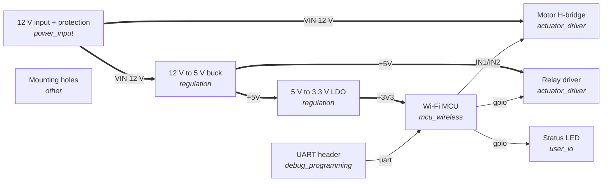

# Design report: 12 V Wi-Fi controller for a small DC motor and a 5 V relay.

> **AI-GENERATED DESIGN PLAN - NOT VERIFIED FOR FABRICATION. This output was produced with the help of a language model and deterministic rule checks. It must be reviewed and signed off by a qualified electronics engineer before any fabrication, assembly or use.**

- **Check status:** `PASS_WITH_WARNINGS` (0 errors, 5 warnings, 7 info)
- **Plan version:** v1
- **Review status:** draft
- **Created:** 2026-11-26T15:20:32+00:00
- **LLM:** mock / `mock-llm` (fixtures: architecture/relay_motor_12v, components/relay_motor_12v, requirements/relay_motor_12v)
  - Mock mode: the LLM answers are hand-authored fixtures, not model output.
- **KiCad DRC:** KiCad DRC ran via kicad-cli-docker: Found 89 violations; Found 81 unconnected items

## Prompt

> 12 V DC-powered Wi-Fi controller for a small brushed DC motor (up to 0.5 A) and one 5 V relay output. Reverse-polarity, overcurrent and surge protection on the input, screw terminals for the motor and the relay contacts, a UART programming header, a status LED and four M3 mounting holes on an 80 x 60 mm board.

## Findings

### WARNING (5)

| ID | Category | Message | Suggested fix |
|---|---|---|---|
| `DFM-DRILL:U3` | DFM | U3 pad 39 drill 0.2 mm < fab minimum 0.3 mm (thermal vias inside the footprint's ground pad). | Use a fab that drills this size, or edit the footprint's thermal vias to the fab minimum. |
| `DRC-DRILL_OUT_OF_RANGE:footprint` | DRC | KiCad DRC drill_out_of_range: 12 item(s). Hole size out of range (board setup constraints min hole 0.3000 mm; actual 0.2000 mm) [PTH pad 39 [GND] of U3] \| Hole size out of range (board setup constraints min hole 0.3000 mm; actual 0.2000 mm) [PTH pad 39 [GND] of U3] \| Hole size out of range (board setup constraints min hole 0.3000 mm; actual 0.2000 mm) [PTH pad 39 [GND] of U3] \| Hole size out of range (board setup constraints min hole 0.3000 mm; actual 0.2000 mm) [PTH pad 39 [GND] of U3] (+8 more) All inside the KiCad library footprint(s) of U3: check that your fab accepts them or adapt the footprint. |  |
| `DFM-DECOUPLING-DISTANCE:C4->U1.2` | placement | C4 is 5.4 mm from U1 pin 2 (limit 5 mm). | Move the capacitor next to the pin. |
| `DFM-DECOUPLING-DISTANCE:C6->U2.5` | placement | C6 is 4.9 mm from U2 pin 5 (limit 3 mm). | Move the capacitor next to the pin. |
| `REQ-OUT-OF-SCOPE:1` | requirements | Out of scope for this tool, not designed: switching mains voltage through the relay contacts |  |

### INFO (7)

| ID | Category | Message | Suggested fix |
|---|---|---|---|
| `DFM-MIXED-ASSEMBLY:plan` | DFM | 5 through-hole part(s) (J1, J2, K1, J3, J4) need a second assembly step (wave/selective/hand soldering). |  |
| `DRC-LIB_FOOTPRINT_ISSUES:warning` | DRC | KiCad DRC lib_footprint_issues: 39 item(s). The current configuration does not include the library 'Connector_BarrelJack'. [Footprint J1] \| The current configuration does not include the library 'Fuse'. [Footprint F1] \| The current configuration does not include the library 'Diode_SMD'. [Footprint D1] \| The current configuration does not include the library 'Diode_SMD'. [Footprint D2] (+35 more) Expected here: the board was checked without the KiCad footprint library tables. |  |
| `DRC-SILK_EDGE_CLEARANCE:warning` | DRC | KiCad DRC silk_edge_clearance: 2 item(s). Silkscreen clipped by board edge [Segment on Edge.Cuts; Reference 'H1'] \| Silkscreen clipped by board edge [Segment on Edge.Cuts; Reference 'H2'] Expected here: silkscreen near the edge on edge-mounted connectors. |  |
| `DRC-SILK_OVERLAP:warning` | DRC | KiCad DRC silk_overlap: 21 item(s). Silkscreen overlap [Reference 'F1'; Segment on F.Silkscreen] \| Silkscreen overlap [Reference 'K1'; Segment on F.Silkscreen] \| Silkscreen overlap [Reference 'D2'; Segment on F.Silkscreen] \| Silkscreen overlap [Segment on F.Silkscreen; Reference 'D1'] (+17 more) Expected here: silkscreen reference positions come from the library footprints. |  |
| `DRC-SILK_OVER_COPPER:warning` | DRC | KiCad DRC silk_over_copper: 15 item(s). Silkscreen clipped by solder mask [Reference 'D2'] \| Silkscreen clipped by solder mask [Reference 'U1'] \| Silkscreen clipped by solder mask [Reference 'U3'] \| Silkscreen clipped by solder mask [Reference 'K1'] (+11 more) Expected here: silkscreen reference positions come from the library footprints. |  |
| `DRC-UNCONNECTED_ITEMS:error` | DRC | KiCad DRC unconnected_items: 81 item(s). Missing connection between items [Pad 2 [GND] of C9 on F.Cu; Pad 2 [GND] of C8 on F.Cu] \| Missing connection between items [Pad 2 [GND] of C5 on F.Cu; Pad 2 [GND] of C6 on F.Cu] \| Missing connection between items [Pad 2 [GND] of C8 on F.Cu; Pad 2 [GND] of C7 on F.Cu] \| Missing connection between items [Pad 2 [GND] of U2 on F.Cu; Pad 2 [GND] of C6 on F.Cu] (+77 more) Expected here: routing is a manual step; every ratsnest line is reported. |  |
| `LIB-NO-DATASHEET:plan` | library | No trusted datasheet URL for J1, F1, J2, J3, J4, D4 (KiCad metadata has none; URLs are never guessed). Look these up from the manufacturer. |  |

## Requirements

- drive one brushed DC motor up to 0.5 A in both directions
- switch one 5 V relay with contacts on a screw terminal
- protect the 12 V input against reverse polarity, overcurrent and surges
- UART programming header, status LED, four M3 mounting holes

| Source | Nominal V | Range V | Capacity mAh | Max mA | Notes |
|---|---|---|---|---|---|
| dc_jack | 12.0 | 11.0-13.0 |  | 1000.0 | 12 V 1 A wall adapter, centre positive |

- size <= 80 x 60 mm
- wireless: wifi
- actuators: dc_motor, relay

### Assumptions

- 12 V 1 A centre-positive barrel adapter *(fills `power_sources`)*
- Relay contacts switch low-voltage loads only (<= 30 V DC) *(fills `actuators`)*
- Motor runs from the protected 12 V rail *(fills `actuators`)*
- Programming via external USB-UART adapter *(fills `interfaces`)*

### Open questions

- Motor stall current (sets the driver current limit)?

### Out of scope

- switching mains voltage through the relay contacts

## Architecture

| Block | Kind | Covers |
|---|---|---|
| power_in | power_input | 12 V, protection |
| buck | regulation | +5V |
| ldo | regulation | +3V3 |
| mcu | mcu_wireless | wifi |
| motor | actuator_driver | dc_motor |
| relay | actuator_driver | relay |
| debug | debug_programming | UART |
| ui | user_io | status LED |
| mech | other | M3 holes |

Rationale: Buck avoids dissipating 7 V across a linear regulator; LDO cleans the 3.3 V.

## Components

| Ref | Role | MPN | Value | Footprint | Verified | Conf. | Status | Rationale |
|---|---|---|---|---|---|---|---|---|
| J1 | 12 V barrel jack | PJ-063AH |  | BarrelJack_CUI_PJ-063AH_Horizontal | yes | 0.85 | proposed | common 2.1 mm DC jack |
| F1 | input resettable fuse | MF-MSMF110-2 |  | Fuse_1812_4532Metric | yes | 0.80 | proposed | 1.1 A hold PTC above the ~0.75 A load |
| D1 | reverse-polarity series diode | SS14 |  | D_SMA | yes | 0.75 | proposed | 1 A Schottky in series with VIN |
| D2 | input surge TVS | SMAJ15A |  | D_SMA | yes | 0.80 | proposed | 15 V standoff above the 13 V max input |
| U1 | 12 V to 5 V buck | LM2596S-5.0/NOPB |  | TO-263-5_TabPin3 | yes | 0.75 | proposed | fixed 5 V, 3 A, simple asynchronous buck |
| U2 | 5 V to 3.3 V LDO | AP2112K-3.3TRG1 |  | SOT-23-5 | yes | 0.80 | proposed | 600 mA LDO from 5 V |
| U3 | main Wi-Fi MCU | ESP32-WROOM-32E-N4 |  | ESP32-WROOM-32E | yes | 0.80 | proposed | Wi-Fi module with plenty of GPIO |
| U4 | DC motor H-bridge | DRV8871DDAR |  | Texas_HTSOP-8-1EP_3.9x4.9mm_P1.27mm_EP2.95x4.9mm_Mask2.4x3.1mm_ThermalVias | yes | 0.80 | proposed | 3.6 A peak H-bridge with current limit, 6.5-45 V |
| J2 | motor output terminal | 1935161 |  | TerminalBlock_Phoenix_MKDS-1,5-2-5.08_1x02_P5.08mm_Horizontal | yes | 0.85 | proposed | 2-way 5.08 mm screw terminal |
| K1 | 5 V relay | SRD-05VDC-SL-C |  | Relay_SPDT_SANYOU_SRD_Series_Form_C | yes | 0.80 | proposed | common SPDT 5 V relay |
| Q1 | relay coil driver | AO3400A |  | SOT-23 | yes | 0.85 | proposed | logic-level N-MOSFET |
| D3 | relay flyback diode | 1N4148W-7-F |  | D_SOD-123 | yes | 0.85 | proposed | clamps coil turn-off spike |
| J3 | relay contacts terminal | 1935174 |  | TerminalBlock_Phoenix_MKDS-1,5-3-5.08_1x03_P5.08mm_Horizontal | yes | 0.85 | proposed | 3-way terminal for COM/NO/NC |
| J4 | UART programming header | 61300411121 |  | PinHeader_1x04_P2.54mm_Vertical | yes | 0.80 | proposed | 4-pin 2.54 mm header for a USB-UART adapter |
| D4 | status LED | LTST-C191KGKT | green | LED_0603_1608Metric | yes | 0.80 | proposed | green indicator |
| H1 | M3 mounting hole #1 | MOUNTING-HOLE-M3 |  | MountingHole_3.2mm_M3 | yes | 0.90 | proposed | four corner holes |
| H2 | M3 mounting hole #2 | MOUNTING-HOLE-M3 |  | MountingHole_3.2mm_M3 | yes | 0.90 | proposed | four corner holes |
| H3 | M3 mounting hole #3 | MOUNTING-HOLE-M3 |  | MountingHole_3.2mm_M3 | yes | 0.90 | proposed | four corner holes |
| H4 | M3 mounting hole #4 | MOUNTING-HOLE-M3 |  | MountingHole_3.2mm_M3 | yes | 0.90 | proposed | four corner holes |
| C1 | Input capacitor (10u) for 12 V to 5 V buck | GRM21BR61E106KA73L | 10u | C_0805_2012Metric | yes | 0.90 | proposed | Input capacitor on VIN |
| C2 | Input capacitor (100n) for 12 V to 5 V buck | GRM188R71H104KA93D | 100n | C_0603_1608Metric | yes | 0.90 | proposed | Input capacitor on VIN |
| L1 | Buck inductor for 12 V to 5 V buck | SRN8040TA-330M | 33u | L_Bourns_SRN8040TA | yes | 0.90 | proposed | 33 uH per the LM2596 typical application for 5 V output |
| D5 | Catch (freewheel) diode for 12 V to 5 V buck | SS14 |  | D_SMA | yes | 0.90 | proposed | Schottky freewheel diode required by the asynchronous buck |
| C3 | Output capacitor (22u) for 12 V to 5 V buck | GRM21BR61C226ME44L | 22u | C_0805_2012Metric | yes | 0.90 | proposed | Output capacitor on +5V |
| C4 | Output capacitor (22u) for 12 V to 5 V buck | GRM21BR61C226ME44L | 22u | C_0805_2012Metric | yes | 0.90 | proposed | Output capacitor on +5V |
| C5 | Input capacitor (1u) for 5 V to 3.3 V LDO | GRM155R61A105KE15D | 1u | C_0402_1005Metric | yes | 0.90 | proposed | Input capacitor on +5V |
| C6 | Output capacitor (1u) for 5 V to 3.3 V LDO | GRM155R61A105KE15D | 1u | C_0402_1005Metric | yes | 0.90 | proposed | Output capacitor on +3V3 |
| C7 | Decoupling (10u) for main Wi-Fi MCU | GRM188R61A106KE69D | 10u | C_0603_1608Metric | yes | 0.90 | proposed | Decoupling on +3V3 |
| C8 | Decoupling (100n) for main Wi-Fi MCU | GRM155R71C104KA88D | 100n | C_0402_1005Metric | yes | 0.90 | proposed | Decoupling on +3V3 |
| R1 | EN pull-up (10k) | RC0402FR-0710KL | 10k | R_0402_1005Metric | yes | 0.90 | proposed | EN pull-up |
| C9 | EN reset-delay capacitor (1u) for main Wi-Fi MCU | GRM155R61A105KE15D | 1u | C_0402_1005Metric | yes | 0.90 | proposed | EN reset-delay capacitor on MCU_EN |
| SW1 | BOOT button (hold during reset for download mode) | PTS810 SJM 250 SMTR LFS |  | SW_SPST_PTS810 | yes | 0.90 | proposed | boot strapping pin needs a way to be pulled low |
| SW2 | RESET (EN) button | PTS810 SJM 250 SMTR LFS |  | SW_SPST_PTS810 | yes | 0.90 | proposed | no USB auto-reset; manual reset needed for programming |
| R2 | LED series resistor (1k) | RC0402FR-071KL | 1k | R_0402_1005Metric | yes | 0.90 | proposed | LED series resistor |
| R3 | Gate series resistor (1k) | RC0402FR-071KL | 1k | R_0402_1005Metric | yes | 0.90 | proposed | Gate series resistor |
| R4 | Gate pull-down (relay off at reset) (100k) | RC0402FR-07100KL | 100k | R_0402_1005Metric | yes | 0.90 | proposed | Gate pull-down (relay off at reset) |
| C10 | Bulk capacitor (10u) for DC motor H-bridge | GRM21BR61E106KA73L | 10u | C_0805_2012Metric | yes | 0.90 | proposed | Bulk capacitor on VIN |
| C11 | Decoupling (100n) for DC motor H-bridge | GRM188R71H104KA93D | 100n | C_0603_1608Metric | yes | 0.90 | proposed | Decoupling on VIN |
| R5 | Current-limit resistor (100k) | RC0402FR-07100KL | 100k | R_0402_1005Metric | yes | 0.90 | proposed | Current-limit resistor |

## Power tree and budget

| Rail | Nominal | Range | Source | From | Capability mA | Peak mA | Active mA | Sleep uA |
|---|---|---|---|---|---|---|---|---|
| VIN | 11.5 V | 10.5-13 V | dc_input J1 | - | 1000.0 | 736.9 | 592.50 | 541350.4 |
| +5V | 5 V | 4.85-5.15 V | buck U1 | VIN | 3000.0 | 453.4 | 171.06 | 71065.0 |
| +3V3 | 3.3 V | 3.201-3.399 V | ldo U2 | +5V | 600.0 | 381.3 | 100.00 | 10.0 |

## Netlist

| Net | Class | Pins | Connections |
|---|---|---|---|
| GND | ground | 31 | C1.2 C2.2 C3.2 C4.2 C5.2 C6.2 C7.2 C8.2 C9.2 C10.2 C11.2 D2.2 D4.1 D5.2 J1.2 J4.1 Q1.2 R4.2 R5.2 SW1.2 SW2.2 U1.3 U1.5 U2.2 U3.1 U3.15 U3.38 U3.39 U4.1 U4.7 U4.9 |
| +3V3 | power | 7 | C6.1 C7.1 C8.1 J4.4 R1.1 U2.5 U3.2 |
| +5V | power | 9 | C3.1 C4.1 C5.1 D3.1 K1.2 L1.2 U1.4 U2.1 U2.3 |
| VIN | power | 8 | C1.1 C2.1 C10.1 C11.1 D1.1 D2.1 U1.1 U4.5 |
| LED1_A | signal | 2 | D4.2 R2.2 |
| LED1_DRV | signal | 2 | R2.1 U3.10 |
| MCU_BOOT | signal | 2 | SW1.1 U3.25 |
| MCU_EN | signal | 4 | C9.1 R1.2 SW2.1 U3.3 |
| MOTOR1_ILIM | analog | 2 | R5.1 U4.4 |
| MOTOR1_IN1 | signal | 2 | U3.12 U4.3 |
| MOTOR1_IN2 | signal | 2 | U3.13 U4.2 |
| MOTOR1_OUT1 | power | 2 | J2.1 U4.6 |
| MOTOR1_OUT2 | power | 2 | J2.2 U4.8 |
| RELAY1_COIL | power | 3 | D3.2 K1.5 Q1.3 |
| RELAY1_COM | power | 2 | J3.1 K1.1 |
| RELAY1_DRV | signal | 2 | R3.1 U3.11 |
| RELAY1_GATE | signal | 3 | Q1.1 R3.2 R4.1 |
| RELAY1_K3 | power | 2 | J3.2 K1.3 |
| RELAY1_K4 | power | 2 | J3.3 K1.4 |
| SW_5V | power | 3 | D5.1 L1.1 U1.2 |
| UART_RX | signal | 2 | J4.3 U3.34 |
| UART_TX | signal | 2 | J4.2 U3.35 |
| VIN_F | power | 2 | D1.2 F1.2 |
| VIN_RAW | power | 2 | F1.1 J1.1 |

28 explicit no-connects

- J1.MP: mechanical mounting pin
- U2.4: NC per KiCad symbol
- U3.4: unused GPIO
- U3.5: unused GPIO
- U3.6: unused GPIO
- U3.7: unused GPIO
- U3.8: unused GPIO
- U3.9: unused GPIO
- U3.14: strapping pin left at its internal default
- U3.16: unused GPIO
- U3.17: NC per KiCad symbol
- U3.18: NC per KiCad symbol
- U3.19: NC per KiCad symbol
- U3.20: NC per KiCad symbol
- U3.21: NC per KiCad symbol
- U3.22: NC per KiCad symbol
- U3.23: strapping pin left at its internal default
- U3.24: strapping pin left at its internal default
- U3.26: unused GPIO
- U3.27: unused GPIO
- U3.28: unused GPIO
- U3.29: strapping pin left at its internal default
- U3.30: unused GPIO
- U3.31: unused GPIO
- U3.32: NC per KiCad symbol
- U3.33: unused GPIO
- U3.36: unused GPIO
- U3.37: unused GPIO

## Constraints

- Board 80 x 60 mm, 1.6 mm thick, 2 layers, fab profile `generic_2layer`.
- Trace widths: IPC-2221 external layer, dT=10C, 1 oz Cu: I = 0.048 * dT^0.44 * A^0.725 (A in mil^2).

| Net class | Width mm | Clearance mm | Via mm | Max mA | Rationale |
|---|---|---|---|---|---|
| Default | 0.2 | 0.15 | 0.6/0.3 |  | fab minimum 0.15 mm rounded up for yield |
| Power | 0.4 | 0.15 | 0.8/0.4 | 736.9 | IPC-2221 external, dT=10C, 1 oz: 737 mA x1.25 margin -> 0.268 mm (min 0.4 mm) |
| Ground | 0.4 | 0.15 | 0.6/0.3 |  | return currents; use a pour on B.Cu, short stubs elsewhere |

- Decoupling: C1, C2 within 5 mm of U1 pin 1
- Decoupling: C3, C4 within 5 mm of U1 pin 2
- Decoupling: C5 within 3 mm of U2 pin 1
- Decoupling: C6 within 3 mm of U2 pin 5
- Decoupling: C7, C8 within 5 mm of U3 pin 2
- Decoupling: C11 within 5 mm of U4 pin 5
- Keepout `U3_antenna` (rf): x 23.8-72.2, y 0.0-21.8 mm on F.Cu, B.Cu. PCB antenna region of the module (from its footprint courtyard, above the pads) plus the strip to the board edge: no copper on any layer. Confirm against the module datasheet's keepout drawing.
- Mounting hole H1 at (4, 4) mm, drill 3.2 mm
- Mounting hole H2 at (76, 4) mm, drill 3.2 mm
- Mounting hole H3 at (4, 56) mm, drill 3.2 mm
- Mounting hole H4 at (76, 56) mm, drill 3.2 mm
- J1 on the left edge (power input)
- U3 on the top edge (PCB antenna must overhang/face the edge)
- J2 on the right edge (field wiring)
- J3 on the right edge (field wiring)
- J4 on the bottom edge (cable access)

## Placement

Algorithm: zone shelf-packing with proximity ordering (deterministic).

| Zone | Kind | Area (x, y, w, h mm) | Purpose |
|---|---|---|---|
| power | power | 0.8, 7.2, 28.1, 42.5 | Power entry, protection, charging and regulation; keep high-current loops short. |
| mcu | mcu | 23.8, 0.0, 48.5, 45.9 | MCU and its local decoupling/strapping. |
| driver | driver | 15.4, 19.4, 63.9, 32.4 | Actuator drivers next to their output terminals; wide copper for load current. |
| general | general | 0.5, 0.5, 78.9, 58.9 | User I/O and miscellaneous parts. |
| connector | connector | 0.0, 22.3, 80.0, 37.7 | Edge connectors. |
| U3_antenna | rf | 23.8, 0.0, 48.5, 21.8 | Antenna keepout: no copper, components or vias on any layer. |

| Ref | X mm | Y mm | Rot | Zone | Hint |
|---|---|---|---|---|---|
| C1 | 7.50 | 10.00 | 0 | power | C1 within 5mm of U1 pin 1 |
| C10 | 65.50 | 49.00 | 0 | driver | C10 within 10mm of U4 pin 5 |
| C11 | 62.00 | 51.00 | 0 | driver | C11 within 5mm of U4 pin 5 |
| C2 | 4.00 | 10.00 | 0 | power | C2 within 5mm of U1 pin 1 |
| C3 | 2.50 | 15.50 | 0 | power | C3 within 5mm of U1 pin 2 |
| C4 | 2.50 | 13.00 | 0 | power | C4 within 5mm of U1 pin 2 |
| C5 | 2.00 | 38.00 | 0 | power | C5 within 3mm of U2 pin 1 |
| C6 | 2.00 | 39.50 | 0 | power | C6 within 3mm of U2 pin 5 |
| C7 | 36.50 | 23.00 | 0 | mcu | C7 within 5mm of U3 pin 2 |
| C8 | 37.00 | 24.50 | 0 | mcu | C8 within 5mm of U3 pin 2 |
| C9 | 37.00 | 26.00 | 0 | mcu | C9 within 10mm of U3 pin 3 |
| D1 | 11.50 | 39.00 | 0 | power |  |
| D2 | 19.00 | 42.00 | 0 | power |  |
| D3 | 77.00 | 20.50 | 0 | driver |  |
| D4 | 48.00 | 51.00 | 0 | general |  |
| D5 | 13.00 | 9.00 | 0 | power | D5 within 10mm of U1 pin 2 |
| F1 | 26.00 | 42.50 | 0 | power |  |
| H1 | 4.00 | 4.00 | 0 | general |  |
| H2 | 76.00 | 4.00 | 0 | general |  |
| H3 | 4.00 | 56.00 | 0 | general |  |
| H4 | 76.00 | 56.00 | 0 | general |  |
| J1 | 6.00 | 24.50 | 0 | connector | rotate so the mating face points off the board |
| J2 | 71.87 | 28.00 | 0 | connector | rotate so the mating face points off the board |
| J3 | 66.79 | 39.50 | 0 | connector | rotate so the mating face points off the board |
| J4 | 40.00 | 50.60 | 0 | connector | rotate so the mating face points off the board |
| K1 | 17.00 | 32.00 | 0 | driver |  |
| L1 | 7.50 | 45.50 | 0 | power | L1 within 10mm of U1 pin 2 |
| Q1 | 64.00 | 30.00 | 0 | driver |  |
| R1 | 37.00 | 27.50 | 0 | mcu | R1 within 10mm of U3 pin 3 |
| R2 | 49.00 | 49.50 | 0 | general | R2 within 10mm of D4 pin 2 |
| R3 | 63.00 | 27.50 | 0 | driver | R3 within 10mm of Q1 pin 1 |
| R4 | 60.50 | 29.00 | 0 | driver | R4 within 10mm of Q1 pin 1 |
| R5 | 56.00 | 50.50 | 0 | driver | R5 within 10mm of U4 pin 4 |
| SW1 | 51.50 | 44.00 | 0 | mcu | SW1 within 10mm of U3 pin 25 |
| SW2 | 35.00 | 42.50 | 0 | mcu | SW2 within 10mm of U3 pin 3 |
| U1 | 15.00 | 17.00 | 0 | power |  |
| U2 | 5.50 | 39.00 | 0 | power |  |
| U3 | 48.00 | 28.00 | 0 | mcu |  |
| U4 | 59.00 | 47.00 | 0 | driver |  |

- Coordinates are footprint origins in mm from the board's top-left corner.
- This is a deterministic starting placement; refine it in KiCad.
- Edge connectors are flush with their edge at 0 deg; rotate them so the mating face points off the board.

## Routing guidance

Stackup: F.Cu 0.035 mm / Core 1.53 mm / B.Cu 0.035 mm

1. **antenna keepout** - keep the module antenna area free of copper first
2. **SW_5V** - switching node: minimise the loop VIN cap -> regulator -> diode -> GND
3. **VIN, +5V, +3V3** - power rails at Power net-class width; star from the source
4. **decoupling** - decoupling caps: pad -> cap -> via to GND, shortest possible
5. **MOTOR1_ILIM** - analog/sense nets away from switching nodes and RF
6. **remaining signals** - Default net class

- Ground: 2-layer: solid GND pour on B.Cu, kept unbroken under the MCU, USB pair and regulators; GND pour on F.Cu stitched to B.Cu with vias every ~5 mm and around the board edge. Route signals on F.Cu; use B.Cu only for short jumpers so the ground plane is not cut.
- Every signal crossing between zones needs continuous GND underneath it.
- Do not route traces through the antenna keepout on any layer.
- Place the buck input capacitor, catch diode and inductor in one tight loop.
- Motor output currents return through GND: give the driver its own GND vias.
- Signal vias 0.6/0.3 mm (diameter/drill, fab minimum).
- Power/GND vias 0.8/0.4 mm; use at least two in parallel per amp of current.
- No vias inside SMD pads unless the fab offers filled/capped via-in-pad.
- C1, C2 within 5 mm of U1 pin 1 (LM2596S-5.0/NOPB)
- C3, C4 within 5 mm of U1 pin 2 (LM2596S-5.0/NOPB)
- C5 within 3 mm of U2 pin 1 (AP2112K-3.3TRG1)
- C6 within 3 mm of U2 pin 5 (AP2112K-3.3TRG1)
- C7, C8 within 5 mm of U3 pin 2 (ESP32-WROOM-32E-N4)
- C11 within 5 mm of U4 pin 5 (DRV8871DDAR)
- K1 contacts: keep contact traces >= 2 mm from logic and wide enough for the switched load (only low-voltage loads are in scope).

## Design notes (deterministic stages)

- SS14 in series with VIN for reverse-polarity protection (drops ~0.5 V).
- PJ-063AH: centre pin (symbol pin 1) assumed positive; confirm adapter polarity.
- LM2596S-5.0/NOPB ~ON/OFF tied low: always on.
- LM2596S-5.0/NOPB: the datasheet design uses low-ESR electrolytic output capacitance; the ceramic-only output here must be checked for loop stability. Catch diode SS14 is rated 1 A.
- AP2112K-3.3TRG1 enable tied to its input: always on.
- SRD-05VDC-SL-C: contacts on pins 3 and 4 - confirm which is normally-open against the manufacturer's datasheet before labelling.
- DRV8871DDAR ILIM = 100 kOhm (about 0.64 A regulation if I_TRIP = 64 kV/R_ILIM as in the datasheet) - recompute for the actual motor stall current.
- 61300411121 programming header: 1=GND 2=MCU TX 3=MCU RX 4=+3V3 (3.3 V logic).
- GPIO assignment on ESP32-WROOM-32E-N4: ui/led->IO25, RELAY1->IO26, MOTOR1_IN1->IO27, MOTOR1_IN2->IO14.

## Review

No review comments or decisions yet.

## Files

- `board.net`
- `board.kicad_pro`
- `board.kicad_sch`
- `board.kicad_pcb`
- `drc.json`
- `bom.csv`
- `report.md`

---

*AI-GENERATED DESIGN PLAN - NOT VERIFIED FOR FABRICATION. This output was produced with the help of a language model and deterministic rule checks. It must be reviewed and signed off by a qualified electronics engineer before any fabrication, assembly or use.*
